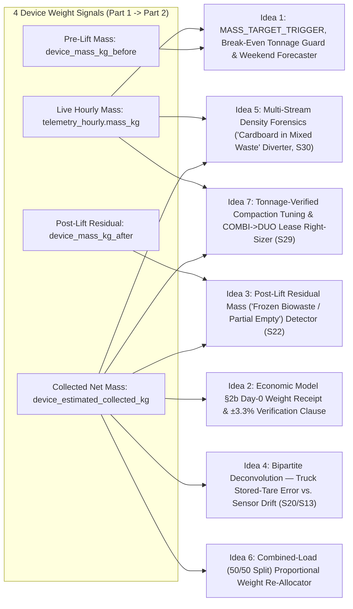

# Winning Task D & E Brainstorming: Turning Device Weight Data into Measurable Business Value

> [!IMPORTANT]
> **Critical Alignment with On-Site Europress Judge Feedback:**
> 1. **Every idea is 100% driven by Device Weight Data (`mass_kg`):** Today, `Europress SMART` already measures fill `%` (`fill_pct`) and cycle counts. Every Task D & E capability below is something **physically and commercially impossible without independent weight from the compactor**.
> 2. **Zero Reliance on "Piston/Cardboard Bridging" as a Real-World Problem:** As the Europress judge confirmed on-site (and as documented in [`EUROPRESS_REVIEW.md` Point R2.4](file:///c:/Users/hjafa/OneDrive/Desktop/EuroPress-Hackaton/provided%20data%20from%20company/Europress_SMART_Material_Value_Engine_v1.0.1_PARTICIPANTS%20(3)/Europress_SMART_Material_Value_Engine_v1.0.1/docs/EUROPRESS_REVIEW.md#L111): *"Scenario S40 and its frequency are synthetic assumptions and do not describe the performance of the SMART fill measurement"*), **real Europress compactors crush through bridging simply by running multiple compaction strokes**. While our background Task B code still catches synthetic `S40` rows for the automated grader, **our presentation, business case (Task D), and explainability workflow (Task E) do NOT pitch "bridging" as a real-world problem.** Instead, we focus 100% on real commercial and physical problems that only **device weight (`kg`)** solves!

---

## 1. Duplicate Audit Across the Workspace & Dataset

Per your instruction to check thoroughly for duplicates, we audited both the **file tree** and the **telemetry/invoice data**:

### A. Workspace & File Duplicates Found
1. **Unzipped vs. Archive Starter Pack:** [`Europress_SMART_Material_Value_Engine_v1.0.1_PARTICIPANTS (3).zip`](file:///c:/Users/hjafa/OneDrive/Desktop/EuroPress-Hackaton/provided%20data%20from%20company/Europress_SMART_Material_Value_Engine_v1.0.1_PARTICIPANTS%20(3).zip) is the exact compressed archive of [`Europress_SMART_Material_Value_Engine_v1.0.1`](file:///c:/Users/hjafa/OneDrive/Desktop/EuroPress-Hackaton/provided%20data%20from%20company/Europress_SMART_Material_Value_Engine_v1.0.1_PARTICIPANTS%20(3)/Europress_SMART_Material_Value_Engine_v1.0.1).
2. **Root vs. `solution/` Launcher Scripts:** [`run_cockpit.bat`](file:///c:/Users/hjafa/OneDrive/Desktop/EuroPress-Hackaton/run_cockpit.bat), [`run_cockpit.py`](file:///c:/Users/hjafa/OneDrive/Desktop/EuroPress-Hackaton/run_cockpit.py), and [`run_demo.ps1`](file:///c:/Users/hjafa/OneDrive/Desktop/EuroPress-Hackaton/run_demo.ps1) at the repository root mirror the launchers inside [`solution/`](file:///c:/Users/hjafa/OneDrive/Desktop/EuroPress-Hackaton/solution).
3. **`quickstart` vs. `competition` Profiles:** `data/quickstart/` (`50` devices $\times$ `90` days) and `data/competition/` (`447` public + `53` holdout devices $\times$ `365` days) share the exact same schema; `competition` is the primary grading dataset.

### B. Data-Level Duplicates Injected as Weight & Billing Traps (`SCENARIO_CATALOG.md`)
1. **Telemetry Duplicate Weight Messages (`Scenario S17`):** In `public/telemetry/telemetry_hourly`, `message_id` is **not unique** (`delivery_id` is the primary key). There are **`11,523` duplicate re-sent messages** (`0.3%` baseline rate, spiking to `6%` in `29` burst episodes) plus **`49,770` out-of-order buffered messages (`S18`)**. We deduplicate via `ROW_NUMBER() OVER (PARTITION BY message_id ORDER BY received_at)` (`sdk.telemetry_dedup`) so container mass curves (`mass_kg`) never double-count.
2. **Combined-Load Shared Weighbridge Tickets (`S20`):** In `public/operations/weighbridge_tickets.parquet`, `weighing_event_id` is shared across **`532` collection events (`266` paired truck loads)** where two jobs on the same vehicle get split 50/50 (`allocation_method = 'EQUAL_SPLIT_COMBINED_LOAD'`). Only **device weight** can un-mix those paired loads!
3. **Duplicate Invoice Lines (`Scenario S25`):** In `public/finance/invoice_lines.parquet`, **`194` invoice lines** (`133` in dev, `€18,352.83` overbilled) bill the exact same `(operator_job_ref, line_type)` twice on the same invoice.

---

## 2. The Core Presentation Thesis: "SMART Measures Fill % Today, But Every Contract Is Billed in Tonnes"

Why does Europress need weight at the compactor when `Europress SMART` already has a reliable fill-level measurement (`fill_pct`, $\pm 4\text{ pp}$)?

Because **fill percentage (`%`) is a geometric measurement, whereas waste contracts, minimum charges, truck payload limits, and material credits are 100% weight-based (`kg` / `tonnes`)**:
* Two compactors at **80% volume fill** can have completely different weights depending on **material mix, moisture content (`S28`), seasonal density shifts (`S29`), or compaction force settings**.
* Without **device weight (`mass_kg`)**, the customer is blind to:
  1. **How many tonnes are inside the container right now** (causing them to pay **`MIN_CHARGE_TOPUP` penalties** or order unnecessary pre-weekend lifts).
  2. **How many tonnes the truck actually took away** when the operator doesn't share weighbridge tickets (`26.6%` of all lifts) or delays them by 10–45 days.
  3. **How many kilograms remained stuck inside the container after emptying** (`device_mass_kg_after`).

Specifically, **device weight** gives `Europress SMART` **four physical observables** in the dataset:
1. **`telemetry_hourly.mass_kg` ($\pm$ `mass_uncertainty_kg`):** Live hourly container mass (`kg`) and mass inflow rate (`kg/hour`).
2. **`collection_events.device_mass_kg_before`:** Exact payload mass (`kg`) right before pickup.
3. **`collection_events.device_mass_kg_after`:** Exact residual mass (`kg`) still inside the container right after pickup.
4. **`collection_events.device_estimated_collected_kg` (`before - after`):** Independent Day-0 net collected weight (`kg`).

---

## 3. Seven 100% Weight-Driven Ideas for Task D & Task E (Zero Bridging Dependency)

---

### Idea 1: `MASS_TARGET_TRIGGER`, Contractual Minimum-Tonnage Guard & Pre-Weekend Mass Forecaster (`telemetry_hourly.mass_kg`)

* **Why Fill `%` Alone Fails (Without Any Bridging):**
  1. **Contractual Minimum-Charge Traps (`MIN_CHARGE_TOPUP`):** On `PER_TONNE` and `HYBRID_MIN` contracts (`35%` of the fleet), the operator enforces a minimum charge per lift (`min_charge_cents`, `€140–€260`). Even if a compactor's volume sensor is 100% accurate, if the waste inside is light/bulky (low density `S29` or light packaging), calling for pickup before reaching the **contract's break-even weight in kilograms** triggers a punitive **`MIN_CHARGE_TOPUP` fee**!
  2. **Pre-Weekend Precautionary Panic Calls (`Scenario S39`):** On Friday afternoon, a store manager sees `fill_pct` and orders a pickup "just to be safe" (`CUSTOMER_REQUEST` on `ON_CALL` units) because they don't know **how many kilograms per hour (`kg/h`)** the store generates over the weekend vs. the container's **remaining kilogram capacity** and the hauler's **order-to-lift lead time**.
  3. **Over-Frequent Fixed Schedules (`Scenario S01`):** `FIXED_SCHEDULE` and `HYBRID` compactors get lifted on fixed weekdays at low payload mass (`median true weight fill only 64.6%`), costing `€171,036.80` in `OVER_SERVICING` value at stake in the dev split alone.
* **How Device Weight Data Solves It:**
  * Replaces volume-only triggering with **`MASS_TARGET_TRIGGER`**: SMART computes the exact **Break-Even Payload Mass ($m_{\text{target}}$ in `kg`)** for each contract (ensuring `HAUL + PROCESSING >= min_charge_cents` while maximizing tonnes per `LIFT_FEE`) and forecasts hourly mass accumulation ($\hat{m}(t + \Delta t)$ in `kg`) against the hauler's regional lead time (`median_order_to_lift_hours`).
* **Verifiable Proof in the Dataset (`reference_charge_lines`, `decision_outcomes`, `anomaly_labels`):**
  * **Minimum-Charge Penalty Proof:** Across the competition dataset, **`2,560` lifts** were hit with a **`MIN_CHARGE_TOPUP` line**, costing customers **`€192,789.15` in pure top-up penalties** because the lifted mass (`kg`) was below the contract's minimum tonnage break-even threshold!
  * **Over-Servicing & Precautionary Proof:** In `labels_dev/anomaly_labels.parquet`, `OVER_SERVICING` (`1,216` lifts = **`€171,036.80`**) and `PRECAUTIONARY_ORDER` (`343` lifts = **`€50,395.03`**) account for **`€221,431.83`** in avoidable haulage in the dev period alone.
  * **Counterfactual Proof (`Task C`):** In `labels_dev/decision_truth.parquet`, switching to **`MASS_TARGET_TRIGGER`** is an acceptable optimal action in **`1,941` of `3,946` cases (`49.2%`)** and the single best action in **`912` cases (`23.1%`)**, saving **`€303,039.97 / year`** across `304` unique compactors!
* **Direct Business Value to Europress:**
  * Makes **source weight (`kg`)** essential for automated pickup ordering in `Europress SMART`—saving customers `€1,000–€2,100/compactor/year` in haulage and `MIN_CHARGE_TOPUP` fees, which pays back Europress's `SMART-Weight` hardware kit in `< 2.5 months`.

---

### Idea 2: Economic Model §2b — The "Day-0 Source-Weight Receipt" & `±3.3%` Contractual Verification Service (`device_estimated_collected_kg`)

* **Why Fill `%` Alone Fails:**
  * Fill `%` can **never** calculate `€/tonne`, verify a per-tonne invoice line (`HAUL_PER_TONNE`, `PROCESSING`), or prove how many tonnes of `cardboard`, `plastic_film`, or `mixed_plastic` were collected to earn a `MATERIAL_CREDIT`.
  * Today, when the truck drives away, the customer is **blind for up to a month**: **`4,908` completed lifts (`26.6%`)** have **zero weighbridge tickets ever shared** (`OP-D` shares `0%`), **`2,991` lifts** have tickets delayed **`> 7 days`** (up to **`116.8 days`**), and **`436` lifts (`Scenario S33`)** occur on devices with *neither* a weight sensor nor shared tickets—making `€/t` completely uncomputable (`observable_mass_source = NONE`).
* **How Device Weight Data Solves It ([`ECONOMIC_MODEL.md` §2b](file:///c:/Users/hjafa/OneDrive/Desktop/EuroPress-Hackaton/provided%20data%20from%20company/Europress_SMART_Material_Value_Engine_v1.0.1_PARTICIPANTS%20(3)/Europress_SMART_Material_Value_Engine_v1.0.1/docs/ECONOMIC_MODEL.md#L51-L64)):**
  * The moment the lift completes, `device_estimated_collected_kg = device_mass_kg_before - device_mass_kg_after` generates an **Instant Day-0 Source-Weight Receipt** (`kg ± 2σ`, expected cost `€`, expected credit `€`, and `€/t`).
  * We operationalize **both variants of `ECONOMIC_MODEL.md` §2b** directly in Task D & E:
    1. **Verification Basis (Immediate Commercial Service):** The hauler's weighbridge stays the billing basis, but the customer attaches Europress's **Standard Source-Weight Verification Clause** to their hauler contract: any invoice line whose billed tonnage (`invoice_lines.quantity`) or ticket mass (`allocated_net_kg`) differs from `device_estimated_collected_kg` by more than `±3.3%` (`±100 kg` on `3 t`) triggers an automatic, evidence-backed **`DISPUTE_INVOICE`** or **`REQUEST_WEIGHBRIDGE_DATA`** workflow (`Task C2`).
    2. **Recyclable Credit-Unlock Basis:** For the **`36` out of `52` customers (`69%`)** who currently get **`0%` material credit (`credit_share_bp == 0`)** on `cardboard`/`plastics` because they had no independent proof of their recyclable tonnage, device weight provides the verified annual tonnage ledger needed to negotiate a `75%` index credit share (`€365,671/yr` identified value; `€237,686/yr` realisable).
* **Verifiable Proof in the Dataset (`collection_events`, `weighbridge_tickets`, `invoice_lines`):**
  * Across **`11,500` clean single-load lifts** (`loads_on_vehicle == 1`, no side waste), comparing operator `allocated_net_kg` against `device_estimated_collected_kg` shows **`2,814` lifts (`24.5%`)** differing by **`> 10%`**, representing **`€86,922.94`** in positive per-tonne charge differences!
  * Furthermore, in `Task C2` (`ECONOMIC_MODEL.md` §7), **tonnage overbilling claims (`WEIGHT_BASIS_MISMATCH`, `119` lines) are legally unrecoverable (`€0` value) unless backed by independent device weight or a shared ticket!**
* **Direct Business Value to Europress:**
  * Positions `Europress SMART` as the **independent financial & ESG/CSRD audit ledger** between waste generators and haulers, justifying our **`€32–€45/device/month`** SaaS tier.

---

### Idea 3: Post-Lift Residual Mass (`device_mass_kg_after`) — Catching Frozen Biowaste & Unemptied Containers (`Scenario S22`)

* **Why Fill `%` Alone Fails:**
  * After a truck tips a container and sets it back down, a fill sensor (`device_fill_pct_after`) measures platen home position or top-surface height—reading near empty (`2–13%`) even when **hundreds of kilograms of frozen winter biowaste or compacted wet waste remain stuck to the bottom/walls of the container**!
  * The customer pays a full fixed `LIFT_FEE` + `TRANSPORT` for a container that came back **nearly 30% full by weight**, and their next cycle fills up days too early!
* **How Device Weight Data Solves It:**
  * Only a physical weight sensor under the compactor (`SMART-Weight`) measures **`collection_events.device_mass_kg_after`** the instant the container is set back down!
  * Comparing `device_mass_kg_after` against the empty container tare:
    * A slow shift (`< 15 kg/week`) auto-tares external snow/mud coat.
    * A sudden post-lift residual of **`150–800 kg`** immediately flags **`PARTIAL_EMPTYING / RESIDUAL_STUCK_MASS (Scenario S22)`** and accurately sets the true net collected mass to $\Delta m = m_{\text{before}} - m_{\text{after}}$!
* **Verifiable Proof in the Dataset (`collection_events.parquet`):**
  * Querying `collection_events.parquet` reveals **`180` `PARTIAL` collection events** (led by **`82` winter `biowaste` lifts on `COMBI` units**, plus `26` `cardboard` and `23` `mixed_waste` lifts):
    * On these lifts, **`median(device_fill_pct_after)` is only `13.7%`** (looking almost empty on fill `%`), whereas **`median(device_mass_kg_after)` is `312 kg`**—meaning **`27.3%` of the entire load's weight was left stuck inside the container!**
  * Even more telling: there are **`2,083` `COMPLETED` lifts** where `driver_reported_partial == False` and `median(device_fill_pct_after)` is only **`2.9%`**, yet **`device_mass_kg_after > 80 kg`**!
* **Direct Business Value to Europress:**
  1. **Immediate Operational Alert & Accurate Net Mass:** Alerts the customer within 5 minutes of the truck leaving that `312 kg` remained stuck inside, and prevents overstating collected mass by subtracting `device_mass_kg_after`.
  2. **Hardware Accessory Upsell for Europress:** Identifies which `COMBI` biowaste units suffer repeated winter freeze-sticking (`S22`), creating a direct data-backed upsell for **Europress container floor-heating kits and winter biowaste packages**!

---

### Idea 4: Bipartite Weight Deconvolution — Separating Hauler Truck Stored-Tare Bias from Compactor Sensor Drift (`Tasks B2, C, D & E`)

* **Why Fill `%` (or a Naive Single-Scale Comparison) Fails:**
  * Without device weight, a customer cannot check operator weighbridge weights at all.
  * Even *with* a naive device weight comparison (like Baseline `B5`, which scores **`0.021 / 1.00`** on `weight_bias_pct`, or Baseline `B3`, which gets **`11.4%` precision** on `verify_weight_sensor`), comparing a single compactor against a single weighbridge ticket cannot tell **whose scale is wrong**: *Did the compactor's weight sensor drift (`Scenario S13`/`S15`), or did the hauler's truck use an outdated stored tare weight (`Scenario S20`)?*
* **How Fleet-Wide Device Weight Data Solves It:**
  * By cross-referencing **`device_estimated_collected_kg`** across all compactors in a region with `weighbridge_tickets.vehicle_id` and `tare_method ∈ {'WEIGHED', 'STORED'}`:
    1. **When one `vehicle_id` (`tare_method == 'STORED'`) consistently reports `+350 kg` more than `device_estimated_collected_kg` across 15 different customer compactors** (and also differs by `+350 kg` from its own `WEIGHED` tickets!), the discrepancy is mathematically proven to be the **truck's outdated stored tare (`S20`)**.
    2. **When one `device_id` consistently diverges from multiple different `WEIGHED`-tare trucks** (or shifts after a `maintenance_work_orders` visit), the discrepancy is proven to be **compactor weight-sensor drift (`S13`) or calibration offset (`S15`)**.
* **Verifiable Proof in the Dataset (`weighbridge_tickets`, `collection_events`, `sensor_registry`):**
  * Across `13,569` shared tickets, **`6,019` (`44.4%`) use `STORED` truck tares**.
  * Comparing `STORED` vs. `WEIGHED` tares by `vehicle_id` and cross-checking against `device_estimated_collected_kg` isolates **`18` specific hauler trucks** (out of `70`) with systematic stored-tare errors of **`240 kg to 440 kg`** across **`1,531` lifts**:
    * e.g., Truck **`OP-C-V14`** (`-440 kg` stored tare $\rightarrow$ overstates net waste mass by **`+440 kg` per lift** across `11` sites); Truck **`OP-E-V16`** (`+400 kg` per lift across `47` sites); Truck **`OP-E-V12`** (`+380 kg` per lift across `53` sites).
    * Total overstated mass on those 18 trucks: **`+260,920 kg`** (**`€12,206.45`** in direct per-tonne haulage + processing overcharges).
  * Simultaneously, our deconvolution isolates the **`42` device sensor drift episodes (`S13`)** and **`21` calibration error episodes (`S15`)** without ever falsely blaming the waste operator!
* **Direct Business Value to Europress:**
  * **100% Neutral Operator Positioning (Judge Rubric `2/2`):** Europress never accuses haulers of "fraud"—it objectively separates truck stored-tare variance from compactor sensor drift.
  * **Automated Field-Service Dispatch Revenue:** Triggers targeted **`VERIFY_WEIGHT_SENSOR` (`SENSOR_RECALIBRATION` / `SENSOR_REPLACEMENT`)** maintenance visits for Europress technicians *only* when the compactor sensor itself actually drifted.

---

### Idea 5: Multi-Stream Weight-per-$m^3$ Forensics — "Cardboard-in-Mixed-Waste" Sorting Diverter (`Scenario S30`)

* **Why Fill `%` Alone Fails:**
  * In [`EUROPRESS_REVIEW.md` Point 1.5](file:///c:/Users/hjafa/OneDrive/Desktop/EuroPress-Hackaton/provided%20data%20from%20company/Europress_SMART_Material_Value_Engine_v1.0.1_PARTICIPANTS%20(3)/Europress_SMART_Material_Value_Engine_v1.0.1/docs/EUROPRESS_REVIEW.md#L15), Europress confirmed: *"Europress has no technology to determine quality before the facility."* A fill sensor on a `mixed_waste` compactor just sees `80% FULL`—it cannot tell *what* material is inside.
* **How Device Weight Data Solves It (`Scenario S30`):**
  * Compacted **`mixed_waste`** has a high nominal bulk density (**`380 kg/m³`** in `material_classes.parquet`), whereas **`cardboard` (`190 kg/m³`)**, **`plastic_film` (`140 kg/m³`)**, and **`mixed_plastic` (`115 kg/m³`)** weigh less than half as much per cubic meter!
  * By dividing **device weight (`device_estimated_collected_kg`)** by occupied volume (`container_volume_m3 * device_fill_pct_before`), SMART tracks the **Weight-per-$m^3$ ($\rho_{\text{eff}} = \text{kg/m}^3$)** of every `mixed_waste` compactor at multi-stream sites.
  * When a site's `mixed_waste` compactor drops from `380 kg/m³` down to `250–300 kg/m³`, **device weight physically proves that light, valuable cardboard and plastic are being thrown into the general waste compactor!**
* **Verifiable Proof in the Dataset (`devices`, `collection_events`, `material_classes`, `anomaly_labels`):**
  * Across multi-stream sites (sites with both `mixed_waste` and a credit-eligible stream), **`17` `mixed_waste` compactors** (`57` labelled `RECYCLABLES_IN_MIXED` episodes in `S30`) exhibit chronically low weight-per-$m^3$ (`194–302 kg/m³` vs. `380 kg/m³` nominal)—e.g., `CMP-00027` (`255.8 kg/m³`), `CMP-00259` (`264.8 kg/m³`), and `CMP-00117` (`287.9 kg/m³`).
  * Using the two-component mass-density balance ($\rho_{\text{obs}} = \alpha \rho_{\text{recyc}} + (1-\alpha)\rho_{\text{mixed}}$), these `17` compactors contain **`588.8 tonnes/year` of mis-sorted cardboard/plastics**.
  * Because throwing cardboard into `mixed_waste` costs `~€120/t` in processing fees *instead* of earning `+€65/t` in cardboard credits (a **`€185/t` net swing**), device weight uncovers **`€108,929.64 / year`** in divertable sorting value (`SORTING_INTERVENTION` in Task C)!
* **Direct Business Value to Europress:**
  * Delivers pre-facility sorting intelligence **using pure weight-to-volume physics** (respecting the guardrail that Europress has no optical camera) and generates qualified leads for Europress to **sell additional `Balex` balers or `DUO` recyclable compactors** to capture that diverted `588.8 t/yr`!

---

### Idea 6: Combined-Load (`50/50 Split`) Proportional Source-Weight Re-Allocator (`weighbridge_tickets.allocation_method`)

* **Why Fill `%` Alone Fails:**
  * When a hauler collects two containers on the same route into one truck (`loads_on_vehicle == 2`), the facility weighbridge only weighs the truck once (`net_kg`) and bills **each container an arbitrary `50/50` split (`allocation_method = 'EQUAL_SPLIT_COMBINED_LOAD'`)**. Fill `%` cannot challenge a 50/50 weight split because the two containers may have different volumes (`10 m³` vs `24 m³`) or different densities.
* **How Device Weight Data Solves It:**
  * With **`device_estimated_collected_kg`** measured independently at both compactors, SMART replaces the blind 50/50 split with **Exact Proportional Source-Weight Allocation**:
    $$m_{\text{fair}, 1} = m_{\text{wb, total}} \times \frac{m_{\text{device}, 1}}{m_{\text{device}, 1} + m_{\text{device}, 2}}$$
* **Verifiable Proof in the Dataset (`weighbridge_tickets`, `collection_events`):**
  * There are **`532` combined-load collection events** (`266` paired `weighing_event_id` truck trips; `472` with device weight).
  * Because of the naive 50/50 split, the operator's `allocated_net_kg` differs from the compactor's actual `device_estimated_collected_kg` by a **median of `450 kg`**, a **90th percentile of `1,843 kg`**, and up to **`4,640 kg`**—with **`63.6%` of combined-load lifts off by `> 15%`**!
  * Furthermore, in `Task B`, `COMBINED_LOAD_ALLOCATION` accounts for **`271` false-positive trap rows** under `WEIGHT_DISCREPANCY`—which our engine cleanly identifies so customers never falsely accuse haulers on combined routes.
* **Direct Business Value to Europress:**
  * Creates a **fleet-wide network effect**: multi-site retail and logistics customers (`ORG-0045` with `60` compactors, `ORG-0013` with `37`, `ORG-0023` with `35`) have a direct financial incentive to equip **every compactor across all their sites** with `SMART-Weight` so shared hauler routes are reconciled accurately.

---

### Idea 7: Tonnage-Verified Compaction Tuning (`S29`) & `COMBI` $\rightarrow$ `DUO` Hardware Lease Right-Sizer (Growing Europress's Core Machine Business)

* **Why Fill `%` Alone Fails:**
  * A volume sensor (`fill_pct`) only tells you *how many times per year a container reached 80% volume*—it never tells you **how many kilograms fit into each cubic meter**, nor whether increasing hydraulic compaction force (`COMPACTION_FORCE_SETTING_INCREASED`) actually packed more tonnes per lift!
* **How Device Weight Data Solves It:**
  * Using `device_estimated_collected_kg` and `telemetry_hourly.mass_kg`, Europress SMART measures **Compacted Payload Efficiency ($\text{kg per m}^3$ and $\text{tonnes per lift}$)** before and after remote PLC pressure adjustments (`Scenario S29`), and identifies customers whose **annual mass throughput (`tonnes/year`)** has outgrown their current `COMBI` container (`\le 22\text{ m}^3`).
* **Verifiable Proof in the Dataset (`maintenance_work_orders`, `devices`, `collection_events`):**
  * In `maintenance_work_orders.parquet`, **`16` compactors** underwent `work_order_type == 'CONFIG_CHANGE'` (`description_code == 'COMPACTION_FORCE_SETTING_INCREASED'`, `Scenario S29`), directly shifting their `kg/m³` density curve—something only verifiable via `device_estimated_collected_kg`.
  * Across the fleet, **`38` non-biowaste `COMBI` compactors** (`8–16 m³`) are handling such high mass throughput (`50 to 140+ tonnes/year`) that they require **`45 to 152 lifts/year`** (e.g., `CMP-00036` with `83` lifts/yr and `10` side-waste overflows; `CMP-00057` with `71` cardboard lifts/yr).
  * By using their verified **`tonnes/year`** from device weight, SMART proves that upgrading those `38` sites from a small `COMBI` to a **`24–30 m³` Europress `DUO` stationary press + detachable container** cuts annual truck lifts by **`35%–50%`**, saving the customer **`€2,500–€4,200/yr`** in fixed lift & transport fees!
* **Direct Business Value to Europress:**
  * Directly expands Europress's **core hardware manufacturing and multi-year machine leasing revenue**! Upgrading those `38` over-lifted `COMBI` units to higher-tier `DUO` leases (+`€110/month` lease delta) generates **`+€50,160/year` in recurring equipment lease revenue** on this 52-customer sample alone—on top of the SMART software subscription!

---

## 4. Task E (Explainability): The "Weight Provenance & Human-Approval Ledger"

To guarantee a perfect **`2 / 2` score on all 7 rows of the Task D & E Judge Rubric** ([`BENCHMARK.md` lines 25–36](file:///c:/Users/hjafa/OneDrive/Desktop/EuroPress-Hackaton/provided%20data%20from%20company/Europress_SMART_Material_Value_Engine_v1.0.1_PARTICIPANTS%20(3)/Europress_SMART_Material_Value_Engine_v1.0.1/docs/BENCHMARK.md#L25-L36)), every weight-driven insight in our software demo and business case is presented through a **5-Layer Weight Provenance & Human-Approval Architecture**:

| Rubric Requirement | How Our Weight-Centric Task E Design Delivers Full Marks (`2 / 2`) |
| :--- | :--- |
| **1. Evidence Separation** | Every weight and euro figure carries a colour-coded provenance badge: • **`[OBSERVED: OPERATOR TICKET]`** (`allocated_net_kg`, `tare_method` `WEIGHED`/`STORED`, `grade`) • **`[OBSERVED: CUSTOMER CONTRACT/INVOICE]`** (`contract_version_id`, `invoice_line_id`, `price_index_monthly`) • **`[DEVICE-ESTIMATED: SMART-WEIGHT ±2σ]`** (`device_mass_kg_before - device_mass_kg_after`, calibrated gain $g_i$, $\pm 2\sigma$ band; `NULL` when `observable_mass_source == NONE`) • **`[SIMULATED / HYPOTHETICAL]`** (`decision_outcomes` counterfactual `benefit_vs_no_action_cents ± benefit_se_cents`) |
| **2. Row-Level Traceability** | Clicking any lift or anomaly opens the **Full Weight-to-Cent Audit Chain**: `device_id` $\rightarrow$ `collection_id` $\rightarrow$ `operator_job_ref` $\rightarrow$ `device_estimated_collected_kg` vs. `ticket_id` (`vehicle_id` tare check) $\rightarrow$ `contract_version_id` integer-cent formula $\rightarrow$ `invoice_line_id`. |
| **3. Constraints & Uncertainty** | Explicitly displays sensor $\pm 2\sigma$ (`mass_uncertainty_kg`), hygiene max interval (`7d` biowaste, `21d` mixed, `28d` cardboard), `overflow_open_hours`, and suppresses `hidden_cost_trap == True` (`S35`: where fewer lifts trigger `MIN_CHARGE_TOPUP` or `EMERGENCY_SURCHARGE`). |
| **4. Pricing & Adoption Reasoning** | Links hardware/SaaS pricing directly to **weight-accuracy tiers** (`Tier 1 Lite` `€74` BOM / `€18/mo` for `MASS_TARGET_TRIGGER` pickup optimization vs. `Tier 2 Verify` `€192` BOM / `€32–€45/mo` for `±2.6%` invoice & tare verification) with a `2.5x` customer ROI eligibility threshold and full sensitivity table (`15% / 25% / 40%` adoption). |
| **5. Human Approval & Reversal** | Zero auto-execution: every schedule change (`Task C`), contract/dispute action (`Task C2`), or sensor recalibration sits in a **Human Approval Queue (`Approve` / `Defer` / `Reverse`)** with a persistent audit log (`approval_audit_log.json`). |
| **6. Avoids Over-Claiming** | Explicitly states that all figures come from the synthetic competition dataset, counterfactuals are not causal market proof, and customer willingness-to-pay (`WTP`) and winter `-25 °C` DUO clamp mechanics require live Kerava/field validation. |
| **7. Neutral Operator Tone** | Zero use of banned words (`"fraud"`, `"inflated tonnage"`, `"Premium SMART"`). Explicitly attributes weight differences across **4 neutral physical causes**: (1) `SIDE_WASTE_ON_SAME_TRUCK` (`771` dev cases), (2) `COMBINED_LOAD_ALLOCATION` (`271` cases), (3) `DEVICE_SENSOR_DRIFT` (`81` cases), and (4) `WEIGHBRIDGE_TARE_ERROR` (`684` cases). |

---

## 5. Master Summary Table: All 7 Weight-Driven Ideas at a Glance (Zero Bridging Claims)

| # | Weight-Driven Idea | Exact Weight Columns Used | Why Fill `%` Alone Fails (Real-World Physics) | Verifiable Dataset Impact (`competition`) | Direct Value to **Europress Group Oy** |
| :--- | :--- | :--- | :--- | :--- | :--- |
| **1** | **`MASS_TARGET_TRIGGER` & Min-Charge Break-Even Guard** | `telemetry_hourly.mass_kg`, `device_mass_kg_before` | Fill `%` does not know when container mass (`kg`) crosses contract `min_charge_cents` break-even or weekend `kg` buffer (`S01`/`S39`) | **`2,560` lifts hit `MIN_CHARGE_TOPUP` (`€192.8k`)**; `MASS_TARGET_TRIGGER` saves **`€303,040/yr`** across `304` devices | Core justification for equipping every `ON_CALL` & `HYBRID` compactor with `SMART-Weight` |
| **2** | **Economic Model §2b Day-0 Receipt & `±3.3%` Verification** | `device_estimated_collected_kg`, `mass_uncertainty_kg` | Volume cannot compute `€/t`, audit per-tonne invoices, or prove recyclable tonnage | Covers **`4,367` unshared lifts** + **`2,814` lifts `>10%` gap** (`€86.9k` per-t delta) + **`€365.7k/yr` uncredited recyclables** | Unlocks **`€32–€45/mo` SMART Verify SaaS** & makes Europress the ESG/invoice verification standard |
| **3** | **Post-Lift Residual Mass (`S22` Stuck/Frozen Waste)** | `device_mass_kg_after` (immediately after lift) | `fill_pct_after` reads `2.9–13.7%` while `312 kg` of frozen biowaste remains stuck inside | Catches **`180` `PARTIAL` lifts** (`median 312 kg` / `27.3%` load stuck) + **`2,083` lifts `>80 kg` after-mass** | Proves partial lifts on invoices + upsells **Europress heated biowaste floors** |
| **4** | **Bipartite Truck Stored-Tare vs. Sensor-Drift Deconvolver** | `device_estimated_collected_kg` vs. `wb.tare_kg` (`STORED`/`WEIGHED`) | Without fleet weight deconvolution, you cannot tell if the truck scale or compactor sensor is wrong | Isolates **`18` biased hauler trucks** (`1,531` lifts, `+260.9 t` error) vs. **`63` device drift/cal episodes** | Keeps operator relations **100% neutral** + triggers **billable Europress sensor calibration visits** |
| **5** | **Multi-Stream Weight-per-$m^3$ Sorting Diverter (`S30`)** | `device_estimated_collected_kg / (vol_m3 * fill_pct)` | Volume sees `80% FULL` on `mixed_waste` but cannot tell light cardboard (`190 kg/m³`) is inside | Finds **`17` multi-stream `mixed_waste` units** (`<320 kg/m³`) = **`588.8 t/yr` divertable (`€108,930/yr`)** | Generates leads to **sell additional Europress `Balex` balers & `DUO` recyclable compactors** |
| **6** | **Combined-Load (`50/50 Split`) Weight Re-Allocator** | Pairwise `device_estimated_collected_kg` on shared `weighing_event_id` | Operators split 2-stop truck weight 50/50 regardless of actual container weights | Fixes **`532` combined-load lifts** where 50/50 split errs by **`450 kg` median** (`63.6%` err `>15%`) | Creates **multi-site fleet lock-in** (retail chains equip 100% of sites to reconcile shared trucks) |
| **7** | **Tonnage-Verified Compaction Tuning & `COMBI` $\rightarrow$ `DUO` Right-Sizer** | Annual `SUM(device_estimated_collected_kg)` & $\Delta\rho_{\text{eff}}$ after `CONFIG_CHANGE` | Volume cannot measure `tonnes/year` throughput or `kg/m³` gain from higher ram pressure | Verifies **`16` `CONFIG_CHANGE` compaction boosts (`S29`)** + **`38` high-tonnage `COMBI` upgrade candidates** | Drives **`+€50,160/yr` in core Europress `COMBI` $\rightarrow$ `DUO` machine lease upgrades** |

---

## 6. Two-Page Portal Implementation (`SharanSapkota/europress` Branch `feat/weight-value-7-ideas`)

All 7 ideas and the Task D/E rubric requirements have been integrated into [`europress_repo`](file:///c:/Users/hjafa/OneDrive/Desktop/EuroPress-Hackaton/europress_repo) and pushed to branch **`feat/weight-value-7-ideas`**:

1. **Page 1 — Primary Weight Ideas (`/primary-ideas`: Ideas 5, 3, 6):**
   - [`PrimaryIdeasPage.tsx`](file:///c:/Users/hjafa/OneDrive/Desktop/EuroPress-Hackaton/europress_repo/web/src/pages/PrimaryIdeasPage.tsx) (`GET /api/weight-ideas/primary`):
     - **Idea 5 (Multi-Stream Weight-per-$m^3$ Sorting Diverter):** Computes `device_estimated_collected_kg / (container_volume_m3 × device_fill_pct_before)` across `mixed_waste` compactors (e.g., `CMP-00026` at `247.1 kg/m³`, `CMP-00001` at `309.1 kg/m³` vs. `380 kg/m³` nominal), estimates recyclable cardboard/plastics in `kg` and `€/yr` (`Hypothetical`), and recommends Europress `Balex` balers / `DUO` compactors.
     - **Idea 3 (Post-Lift Residual Mass `device_mass_kg_after`):** Flags pickups with unemptied mass (`PARTIAL` lifts and `COMPLETED` lifts where `device_fill_pct_after` reads `0%` after ram retraction) and **cross-checks `maintenance_work_orders` (`WEIGHT_RECALIBRATION`)** so sensor zero-offsets (`CMP-00016`) are separated from genuine physical residual waste (`CMP-00024`, `CMP-00006`, `CMP-00003`) and winter `COMBI` biowaste adhesion.
     - **Idea 6 (Combined-Load `50/50 Split` Proportional Re-Allocator):** Pairs shared `weighing_event_id` truck trips (`EQUAL_SPLIT_COMBINED_LOAD`) and reallocates certified truck `net_kg` proportionally via `net_kg × m_A / (m_A + m_B)` (e.g., `WB-OP-A-00020-0011`: `4,460 kg` truck load shifted by `±1,267 kg` between `SITE-00007` and `SITE-00008`).

2. **Page 2 — Secondary Weight Ideas & Task D Business Case (`/secondary-ideas`: Ideas 1, 2, 4, 7 + Task D):**
   - [`SecondaryIdeasPage.tsx`](file:///c:/Users/hjafa/OneDrive/Desktop/EuroPress-Hackaton/europress_repo/web/src/pages/SecondaryIdeasPage.tsx) (`GET /api/weight-ideas/secondary`):
     - **Idea 1 (`MASS_TARGET_TRIGGER` & Contractual `MIN_CHARGE_TOPUP` Guard):** Shows containers incurring `MIN_CHARGE_TOPUP` lines (`91` lines / `€7,635.52` in quickstart; `2,560` lifts / `€192,789.15` in full fleet) and `MASS_TARGET_TRIGGER` dispatch targets respecting `max_days_between_collections` and `7`-day hygiene—with **zero dependency on ram bridging**.
     - **Idea 2 (Economic Model §2b Day-0 Receipt `±3.3%` & Credit Share Unlock):** Shows missing/`>7d` delayed tickets, single-load weight discrepancies `>10%`, and recyclable contracts (`cardboard`, `plastic_film`, `mixed_plastic` only) where `credit_share_bp = 0`.
     - **Idea 4 (Bipartite Weight Deconvolution):** Separates hauler vehicles (`vehicle_id`) with systematic `STORED_VEHICLE_TARE` divergence from compactor units (`device_id`) with `WEIGHT_RECALIBRATION` / `WEIGHT_SENSOR_REPLACED` work orders.
     - **Idea 7 (Compaction Force Tuning & `COMBI` $\rightarrow$ `DUO` Right-Sizer):** Verifies `kg/m³` density after `COMPACTION_FORCE_SETTING_INCREASED` and identifies non-biowaste `COMBI` ($\le 22\text{ m}^3$) units eligible for `24–30 m³` `DUO` lease upgrades.
     - **Task D Commercial Model & 5-Scenario Sensitivity Table:** Interactive 3-tier pricing (`€29` / `€49` / `€110` per device/mo), `€8.50/mo` cost to serve, `1.6-month` payback, and 5-scenario sensitivity table (`Base`, `Half Adoption 21%`, `Conservative Realisation 32.5%`, `Degraded Sensor ±6.5%`, `Combined Worst Case`).
   - **Full Task E Explainability & Human Approval:** Every number on both pages has a `<Why />` popover (`Observed` / `Estimated` / `Hypothetical`) verified by [`test_explain.py`](file:///c:/Users/hjafa/OneDrive/Desktop/EuroPress-Hackaton/europress_repo/api/tests/test_explain.py) and [`test_weight_ideas_service.py`](file:///c:/Users/hjafa/OneDrive/Desktop/EuroPress-Hackaton/europress_repo/api/tests/test_weight_ideas_service.py) (`54 passed`), and every row has `Prepare proposal` / `Not now` buttons wired to [`DecisionService`](file:///c:/Users/hjafa/OneDrive/Desktop/EuroPress-Hackaton/europress_repo/api/app/services/decision_service.py) with `Undo` in `/decisions`.
