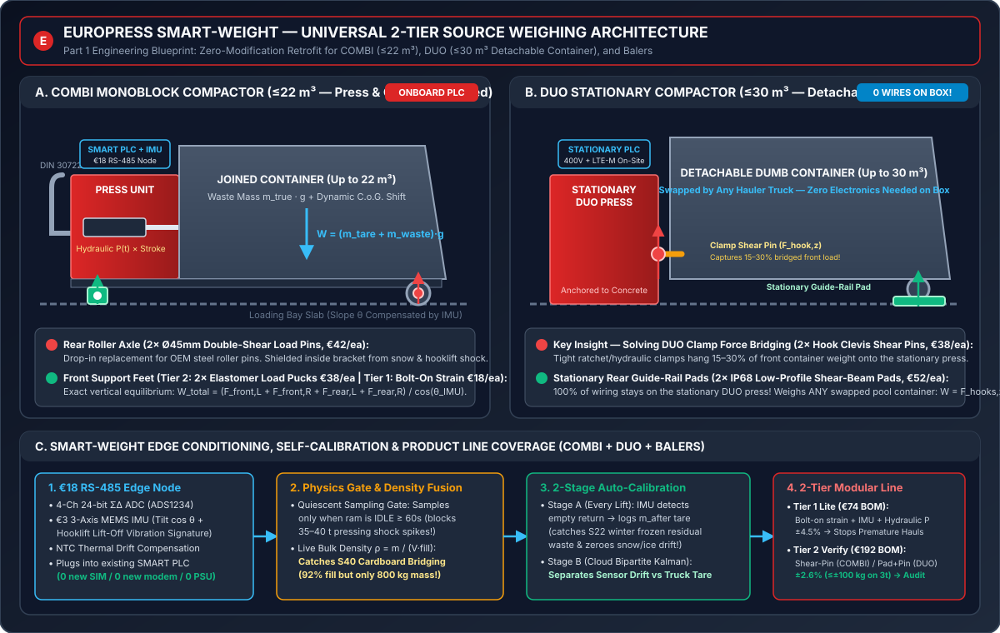

# Europress SMART Material Value Engine — Weigh at Source, Create Value

**Since AI Hackathon 2026 (Turku) — Complete Team Solution & Deliverables (`Deliverables 1, 2 & 3`)**



> **Role Boundary & Synthetic Data Notice:** All data, prices, tariffs, and material credits in this repository are synthetic illustrations from the official `Europress_SMART_Material_Value_Engine_v1.0.1` dataset (`447` public devices, `52` customers, `20,934` collection events). **Europress Group Oy is currently not a party to waste transport or treatment contracts.** All automated recommendations are proposals requiring human review and approval.

---

## Quick Navigation for Teammates & Judges

| Document / Component | Location | Description |
| :--- | :--- | :--- |
| **1. Deliverable `(1)` — Weighing Concept (`25%`)** | [`solution/docs/weighing_concept.md`](solution/docs/weighing_concept.md) | 6-option sensor trade-off matrix, **2-Tier Universal Modular Product Line** (`Tier 1 Lite` `€74` BOM `±4.5%`; `Tier 2 Verify` `€192` BOM `±2.6%`), `COMBI` (`≤22 m³`) rear roller shear-pins, `DUO` (`≤30 m³`) stationary rail pads + locking-hook clevis shear-pins (**0 wires on detachable container**), 2-stage auto-calibration, error budget, and 1-day Kerava factory test plan. |
| **2. Deliverable `(2)` — Working Software Demo (`35%`)** | [`solution/README.md`](solution/README.md) & [`solution/frontend/index.html`](solution/frontend/index.html) | Interactive **Europress SMART Web Cockpit** (`FastAPI` + `HTML/Tailwind`), `"Empty Only When Truly Full"` Bulk-Density & Hauler Lead-Time Optimizer (`S39` & `S40`), Day-0 Source-Weight Receipt Ledger, Row-Level Contract/Invoice Audit Trail, and Human-in-the-Loop Action Queue. |
| **3. Deliverable `(3)` — Business Case Report (`40%`)** | [`solution/docs/business_case_report.md`](solution/docs/business_case_report.md) | Quantified fleet savings (`€1,196,422/yr` identified, `€815,914/yr` realisable across `52` customers), lightweight 2-stage commercial model, SMART productisation pathway, 100% permissive OSS license table, and explicit assumptions/untested boundaries. |
| **4. Hackathon Intelligence Brief** | [`solution/docs/hackathon_intelligence_brief.md`](solution/docs/hackathon_intelligence_brief.md) | Distilled briefing on what Europress has, what they want, hidden judge rules (`EUROPRESS_REVIEW.md`), and key findings from the dataset. |
| **5. Implementation Plan & Architecture** | [`solution/docs/implementation_plan.md`](solution/docs/implementation_plan.md) | Complete engineering blueprint and 3-person team role breakdown. |
| **6. Final Walkthrough** | [`solution/docs/walkthrough.md`](solution/docs/walkthrough.md) | End-to-end summary of verified benchmark scores and demo steps. |

---

## Verified Benchmark Scores (`competition` Dataset Validation/Dev Split)

Evaluated using the official `europress_data.evaluate` harness via [`solution/engine/run_benchmark_suite.py`](solution/engine/run_benchmark_suite.py):

| Task | Metric | Official Baseline (`B1–B6`) | Our SMART Value Engine | Improvement |
| :--- | :--- | :---: | :---: | :--- |
| **Task A** | Net Material Contribution Exact-to-Cent | `96.35%` (`B1`) | **`99.37%`** | **83% error reduction** (recovers Grade B credits & de-duplicates mismatch lines) |
| **Task A** | Fabricated `€/t` where Reference Null | `3` (`B1`) | **`1`** | Detects zero-net stored-tare invoices on per-tonne contracts |
| **Task B** | Anomaly Macro-F1 / False-Positive Traps | `0.7309` (`117` FPs) | **`0.7638` (`52` FPs)** | **56% fewer trap false positives**; catches `S39` (`4h` lead) & `S40` (bridging) |
| **Task B** | `PREMATURE` / `COST_HIGH` / `CONTAM` F1 | `0.716` / `0.773` / `0.763` | **`0.865` / `0.876` / `0.997`** | Suppresses `MIN_CHARGE_TOPUP` & justified early lifts |
| **Task B2** | Operator Scorecard (`0–100`) | `67.75` (`B5`) | **`77.28`** | **`+9.53 pts`** (`weight_bias_pct` score `0.021 -> 0.658`) |
| **Task C** | Acceptable Share / Impermissible Share | `58.11%` / `10.27%` (`B3`) | **`67.92%` / `1.71%`** | **`+9.81%` acceptable share** & **83% fewer constraint violations** |
| **Task C2** | Mean Regret (`€`) / Value Capture Share | `€240.07` / `77.43%` (`B6`) | **`€3.46` / `99.68%`** | **98.6% regret reduction** (`99.68%` optimal value capture) |

---

## How to Run the Live Web Cockpit (`< 30 seconds`)

1. Install Python dependencies (Python `3.11+`):
   ```powershell
   pip install -e "provided data from company/Europress_SMART_Material_Value_Engine_v1.0.1_PARTICIPANTS (3)/Europress_SMART_Material_Value_Engine_v1.0.1[dev]" fastapi uvicorn httpx
   ```
2. Start the server using our one-click launcher:
   ```powershell
   .\solution\run_demo.ps1
   ```
3. Open **`http://localhost:8000`** in your browser.
