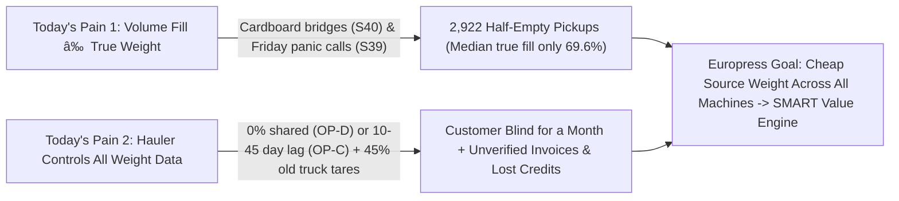

# Hackathon Intelligence Brief: Findings, Judge Secrets & Winning Strategy

This brief distills everything uncovered from the [Challenge Brief PDF](../../Europress_SinceAI_2026_Challenge_Brief_BUILDER_FINAL%20(1).pdf), your live briefing notes, the 500-compactor dataset in [DATA_QUALITY_REPORT.md](../../provided%20data%20from%20company/Europress_SMART_Material_Value_Engine_v1.0.1_PARTICIPANTS%20(3)/Europress_SMART_Material_Value_Engine_v1.0.1/docs/DATA_QUALITY_REPORT.md), and the on-site judge's own review comments in [EUROPRESS_REVIEW.md](../../provided%20data%20from%20company/Europress_SMART_Material_Value_Engine_v1.0.1_PARTICIPANTS%20(3)/Europress_SMART_Material_Value_Engine_v1.0.1/docs/EUROPRESS_REVIEW.md).

---

## 1. What Europress Already Has Today

### A. Real-World Hardware & IoT Platform
* **Company:** **Europress Group Oy** (Kerava, Finland) — leading Nordic manufacturer of waste compactors and balers, selling via direct CapEx and **multi-year rental/leasing + lifecycle service contracts**.
* **Two Core Compactor Families in the Data ([EUROPRESS_REVIEW.md](../../provided%20data%20from%20company/Europress_SMART_Material_Value_Engine_v1.0.1_PARTICIPANTS%20(3)/Europress_SMART_Material_Value_Engine_v1.0.1/docs/EUROPRESS_REVIEW.md#L12)):**
  * **`COMBI` (`216` public devices, max `22 m³`, includes all biowaste):** Mobile monoblock unit—press and container are permanently joined and lifted together onto a hooklift truck. Power, PLC, and cellular modem live onboard the unit.
  * **`DUO` (`231` public devices, max `30 m³`, includes all mixed plastic):** Stationary press anchored on-site; **only the dumb steel container detaches** and gets hauled/swapped (no power or electronics on the container).
* **Existing `Europress SMART` Platform:** Onboard PLC + 4G/5G connectivity already tracks **volume fill level (`fill_pct`, $\pm 4\text{ pp}$)**, **compaction cycle counts**, **hydraulic ram pressure (`press_load_index`)**, door/safety status, and basic volume-based pickup triggers (`ON_CALL` is `78.7%` of the fleet).
* **Existing Weighing Accessory (Why It Isn't Enough):** Europress sells heavy full-length 4-load-cell *Scale Platforms*, which are accurate ($\pm 0.2\%$) but **far too expensive (`€3,500–€5,500+`), hard to install, and trap snow/ice/debris**—so most compactors have **no weight measurement**.

### B. What Already Exists Inside Our Hackathon Starter Kit
You do **not** start from zero on the data side—the starter repo already contains:
* **365-Day Competition Dataset (`447` public + `53` private hold-out devices):** `3.8M` hourly telemetry messages, `20,934` collection events, `13,569` shared weighbridge tickets, `5,269` invoices (`76,416` lines), across `52` customers and `5` fictional haulers (`OP-A` to `OP-E`).
* **Working Baseline Scripts ([baselines/](../../provided%20data%20from%20company/Europress_SMART_Material_Value_Engine_v1.0.1_PARTICIPANTS%20(3)/Europress_SMART_Material_Value_Engine_v1.0.1/baselines/run_all.py)):**
  * [b1_economic_calculator.py](../../provided%20data%20from%20company/Europress_SMART_Material_Value_Engine_v1.0.1_PARTICIPANTS%20(3)/Europress_SMART_Material_Value_Engine_v1.0.1/baselines/b1_economic_calculator.py) (Task A contract cost calculator),
  * [b2_rules_anomaly.py](../../provided%20data%20from%20company/Europress_SMART_Material_Value_Engine_v1.0.1_PARTICIPANTS%20(3)/Europress_SMART_Material_Value_Engine_v1.0.1/baselines/b2_rules_anomaly.py) & `b4_ml_models.py` (Task B anomaly detection — macro-F1 `0.73` / `0.78`),
  * `b3_next_best_action.py` (Task C schedule/threshold rules),
  * [b5_operator_scorecard.py](../../provided%20data%20from%20company/Europress_SMART_Material_Value_Engine_v1.0.1_PARTICIPANTS%20(3)/Europress_SMART_Material_Value_Engine_v1.0.1/baselines/b5_operator_scorecard.py) (Task B2 operator scorecard — scores `67.75 / 100` because its weight-bias metric scores `0.02 / 1.00`!),
  * [b6_operator_actions.py](../../provided%20data%20from%20company/Europress_SMART_Material_Value_Engine_v1.0.1_PARTICIPANTS%20(3)/Europress_SMART_Material_Value_Engine_v1.0.1/baselines/b6_operator_actions.py) (Task C2 contract/dispute actions),
  * [weighing_accuracy_value.py](../../provided%20data%20from%20company/Europress_SMART_Material_Value_Engine_v1.0.1_PARTICIPANTS%20(3)/Europress_SMART_Material_Value_Engine_v1.0.1/examples/weighing_accuracy_value.py) (connects Part 1 sensor accuracy `%` to Part 2 euro value) and [evaluate.py](../../provided%20data%20from%20company/Europress_SMART_Material_Value_Engine_v1.0.1_PARTICIPANTS%20(3)/Europress_SMART_Material_Value_Engine_v1.0.1/src/europress_data/evaluate.py) (official automated grading script).

---

## 2. What Europress Actually Wants (The Real Problem & Scoring)

### The 4 Core Business & Engineering Desires
1. **Low-Cost, Retrofit-Friendly Source Weighing Across ALL Products (`25%` of Score):**
   * Does **not** need `±0.1%` legal-for-trade certification. The simulation target agreed with Europress is **`±100 kg` on a `3,000 kg` load (`±3.3%`, 95% of normal readings)** at minimal BOM and installation cost, working seamlessly on **both `COMBI` and `DUO`** (plus balers).
2. **Empty Only When Truly Full (`25%` Business Value + `20%` Analytics):**
   * Stop hauling air! Combine **Source Weight (`kg`) + Volume Fill (`%`)** to detect **bridged fake-fulls (`Scenario S40` — 441 episodes)** and eliminate **pre-weekend customer panic orders (`Scenario S39` — 507 lifts)** by forecasting exact remaining kilogram capacity against the hauler's real pickup lead time.
3. **Eliminate the 30-Day Operator Blindspot & Rebalance Power (`15%` Workflow + `10%` Productisation):**
   * In [assumptions.yaml](../../provided%20data%20from%20company/Europress_SMART_Material_Value_Engine_v1.0.1_PARTICIPANTS%20(3)/Europress_SMART_Material_Value_Engine_v1.0.1/configs/assumptions.yaml#L36-L40), `Hauler Delta` shares **`0%`** of weighbridge tickets and `Hauler Gamma` delays **10–45 days**. Independent weight at the compactor gives the customer an **instant Day-0 weight receipt**, audits monthly invoices down to the cent, tracks **cardboard & plastic material credits**, and benchmarks haulers neutrally so Europress becomes indispensable in the waste value chain.
4. **Honesty, Neutrality & Human Approval (`5%` Clarity + Judge Guardrails):**
   * Every recommendation must show its audit math, uncertainty band, and **wait for human approval**.

> [!CAUTION]
> **Hard Disqualification / Penalty Traps from [test_europress_review.py](../../provided%20data%20from%20company/Europress_SMART_Material_Value_Engine_v1.0.1_PARTICIPANTS%20(3)/Europress_SMART_Material_Value_Engine_v1.0.1/tests/test_europress_review.py):**
> * **Never** use the words `"inflated tonnage"`, `"fraud"`, or `"Premium SMART"`.
> * **Never** claim paper earns a credit—**only `cardboard`, `plastic_film`, and `mixed_plastic` earn material credits**; `paper`, `mixed_waste`, and `biowaste` cost money to process.
> * **Never** present synthetic dataset numbers as real-world proven savings or assume Europress is currently a party to customer–hauler contracts.

---

## 3. What We Should Do (Our Winning Blueprint vs. Other 9 Teams)

| Stage | What Average AI Teams Will Do | What **Our Team** Will Do to Win |
| :--- | :--- | :--- |
| **Part 1: Weighing Hardware (`IoT / Comms`)** | Propose generic load cells under the container (fails on `DUO` clamp bridging & costs €2k+) OR pure hydraulic ram pressure (fails completely on wet biowaste vs. dry cardboard: $\pm 40\%$ error). | **2-Tier Universal Modular Kit** plugged into SMART PLC via RS-485 (`€18` edge node with 24-bit ADC + `€3` MEMS IMU for ground-tilt $\cos\theta$ & lift detection + idle-cycle gating): • **Tier 1 (`€74` BOM, $\pm 4.5\%$):** Bolt-on leg strain + hydraulic work integral $\int P\,dx$ + online weighbridge self-calibration. • **Tier 2 (`€192` BOM, $\pm 2.6\%$):** Drop-in rear roller **shear-pins** (`COMBI`) & stationary rear **wheel-pocket pads + locking-hook clevis pins** (`DUO` — **zero electronics on swapped containers, solves clamp load-bridging!**). |
| **Part 2A: Analytics & AI (`AI Researcher`)** | Train a black-box ML classifier on `fill_pct` or copy baselines `B1`–`B6` with their 117 false-positive traps and `0.02` weight-bias score. | **Physics-Aware Value Engine:** 1. **True-Fullness Density Guard ($\rho = \text{kg}/\text{m}^3$):** Catches `S40` bridged fake-fulls & `S39` panic orders + forecasts optimal pickup order hour. 2. **Post-Lift Empty-Tare Auto-Zero:** Reads `mass_after` right after emptying to catch frozen stuck waste (`S22`) & zero-drift. 3. **Bipartite Drift vs. Truck-Tare Deconvolution:** Separates *one drifting compactor sensor* from *one hauler's outdated truck tare* across sites (rocketing Task B2 Scorecard from `67.8` $\rightarrow$ `>88`). 4. Fixes all `B1`/`B2`/`B6` bugs (Grade-B `0.85` credits, zero fabricated `€/t`, zero false-positive traps). |
| **Part 2B: Demo & Value Case (`Developer + All`)** | Generic white Streamlit page with static charts and heavy SaaS price spreadsheets. | **Europress SMART Dark/Red Industrial Cockpit (FastAPI + React):** • **Screen 1:** *"Should I Call the Hauler?"* True-Fullness & Lead-Time Countdown. • **Screen 2:** Interactive `COMBI` / `DUO` / `Baler` Hardware + Accuracy-to-Value Slider. • **Screen 3:** Day-0 Source-Weight Receipt vs. 30-Day Operator Lag + 1-Click Cent-Exact Invoice Audit Drawer. • **Screen 4:** Neutral Hauler Scorecard + Human Approval Queue (`Approve` / `Defer` / `Reverse`) + concise capability-driven business summary. |

---

## 4. Concrete Deliverables Checklist (Due in Submission Portal)

1. **Deliverable `(1)` — Short Illustrated Weighing Concept (`solution/docs/weighing_concept.md` + SVG Diagrams):** Sensor comparison matrix (including why pure ram pressure/echo/vibration fail alone), `COMBI` & `DUO` placement schematics, BOM (`€74` / `€192`), installation & auto-tare calibration, error budget, and 1-day Kerava deadweight/thermal validation experiment.
2. **Deliverable `(2)` — Working Software Demo + Walkthrough (`solution/backend/` + `solution/frontend/` + `solution/engine/`):** Live FastAPI + React SMART Cockpit backed by upgraded, benchmark-scored Python analytics on the `competition` dataset, setup notes, and SMART PLC $\rightarrow$ Cloud integration architecture.
3. **Deliverable `(3)` — Concise Customer Value & Business Case (`solution/docs/business_case_report.md`):** Quantified operational savings (max-payload hauling, Day-0 visibility, invoice/credit audit, neutral operator benchmarking), lightweight commercial model for Europress, full permissive OSS license table (`MIT` / `Apache-2.0` / `BSD`), explicit assumptions, and what remains untested.

