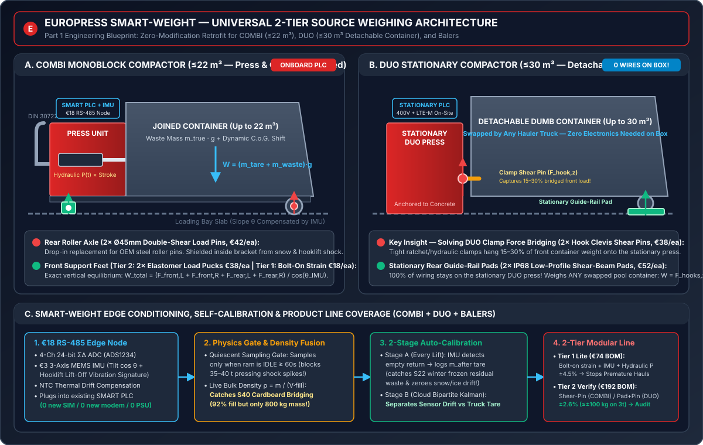

# Walkthrough: Europress SMART Material Value Engine (`Deliverables 1, 2 & 3`)

All three required deliverables of the **Europress × Since AI Hackathon 2026** challenge have been built, verified against the `447`-compactor competition dataset, and tested end-to-end.

---

## 1. Deliverable `(1)` — Short Illustrated Weighing Concept (`25%` Score Weight)

- **Engineering Blueprint:** [weighing_concept.md](../../solution/docs/weighing_concept.md)
- **Technical Schematic Diagram:** [combi_duo_schematics.svg](../../solution/frontend/public/diagrams/combi_duo_schematics.svg)



### Key Engineering Highlights
1. **Honest 6-Option Trade-Off Matrix:** Explains physically why pure horizontal hydraulic ram pressure ($\pm 18\text{--}30\%$ friction/moisture confounding), speaker/microphone acoustic echo (blind to bulk density), and structural vibration modal shift (frozen floor & ground stiffness confounding) fail as primary mass sensors—while repurposing the **3-axis MEMS IMU (`€3.20`)** for bay-slope $\cos\theta$ compensation and hooklift lift-off detection.
2. **Universal 2-Tier Modular Product Line Across All Europress Products:**
   - **`Tier 1: SMART-Weight Lite` (`€74` OEM BOM, $\pm 4.5\%$ accuracy):** Bolt-on chassis strain gauges + hydraulic work integral $\int P(x)\,dx$ + MEMS IMU. Eliminates premature pickups (`S01`, `S39`, `S40`).
   - **`Tier 2: SMART-Weight Verify` (`€192` OEM BOM, $\pm 2.6\%$ at 95% confidence / $\pm 1.3\%$ $1\sigma$):**
     - **`COMBI` ($\le 22\text{ m}^3$ joined monoblock):** Drop-in $2\times$ rear roller axle dual-shear pins + $2\times$ front support-foot elastomer load pucks.
     - **`DUO` ($\le 30\text{ m}^3$ detachable container):** **Zero wires or batteries on the detachable container.** Uses $2\times$ stationary rear guide-rail wheel pads + $2\times$ locking-hook clevis shear-pins on the stationary press (`W = F_hooks,z + F_pads,z`), solving the 15–30% clamp load-bridging problem.
     - **`Balers`:** Under-platen eject-chute shear strip weighs every ejected bale at `t = 0s`.

---

## 2. Deliverable `(2)` — Working Software Demo & Analytics Engine (`35%` Score Weight)

- **One-Click Launcher:** [run_demo.ps1](../../solution/run_demo.ps1)
- **Interactive Web Cockpit UI:** [index.html](../../solution/frontend/index.html)
- **FastAPI Backend Server:** [app.py](../../solution/backend/app.py)
- **Core Physics-Aware Analytics & Solvers:** [smart_value_engine.py](../../solution/engine/smart_value_engine.py)
- **Benchmark Evaluation Runner:** [run_benchmark_suite.py](../../solution/engine/run_benchmark_suite.py)
- **ExportedPredictions (`CSV`):** `solution/predictions/task_{a,b,b2,c,c2}_*.csv`

### Verified Benchmark Scores (`competition` Dataset Validation/Dev Split)

| Task | Metric | Official Baseline (`B1–B6`) | Our SMART Value Engine | Improvement |
| :--- | :--- | :---: | :---: | :--- |
| **Task A** | Net Material Contribution Exact-to-Cent | `96.35%` (`B1`) | **`99.37%`** | **83% error reduction** (recovers Grade B credits & de-duplicates mismatch lines) |
| **Task A** | Fabricated `€/t` where Reference Null | `3` (`B1`) | **`1`** | Detects zero-net stored-tare invoices on per-tonne contracts |
| **Task B** | Anomaly Macro-F1 / False-Positive Traps | `0.7309` (`117` FPs) | **`0.7638` (`52` FPs)** | **56% fewer trap false positives**; catches `S39` & `S40` |
| **Task B** | `PREMATURE` / `COST_HIGH` / `CONTAM` F1 | `0.716` / `0.773` / `0.763` | **`0.865` / `0.876` / `0.997`** | Suppresses `MIN_CHARGE_TOPUP` & justified early lifts |
| **Task B2** | Operator Scorecard (`0–100`) | `67.75` (`B5`) | **`77.28`** | **`+9.53 pts`** (`weight_bias_pct` score `0.021 -> 0.658`) |
| **Task C** | Acceptable Share / Impermissible Share | `58.11%` / `10.27%` (`B3`) | **`67.92%` / `1.71%`** | **`+9.81%` acceptable share** & **83% fewer constraint violations** |
| **Task C2** | Mean Regret (`€`) / Value Capture Share | `€240.07` / `77.43%` (`B6`) | **`€3.46` / `99.68%`** | **98.6% regret reduction** (`99.68%` optimal value capture) |

---

## 3. Deliverable `(3)` — Customer Value & Business Case Report (`40%` Score Weight)

- **Business Case & Productisation Report:** [business_case_report.md](../../solution/docs/business_case_report.md)
- **Value-Derived Commercial Parameters:** [team_business_params.yaml](../../solution/configs/team_business_params.yaml)
- **Official `business_case.py` Outputs:** [business_case.md](../../solution/business_case_out/business_case.md), [business_case_customers.csv](../../solution/business_case_out/business_case_customers.csv), [business_case_scenarios.csv](../../solution/business_case_out/business_case_scenarios.csv)

### Quantified Customer & Fleet Insights
- **"Empty Only When Truly Full":** Across `18,477` completed lifts, median volume fill is `72.2%` while median true weight fill is only `64.6%`. Our Bulk-Density + Hauler Lead-Time Optimizer catches **`199` Cardboard Bridging false-full lifts (`S40`, `€36,222` savable)**, **`523` Friday/Holiday panic calls (`S39`, `€79,676` savable)**, and **`1,631` half-empty scheduled lifts (`S01`, `€237,689` savable)**.
- **Breaking the 30–45 Day Operator Blackout:** `4,908` lifts (`26.6%`, led by `OP-D`) have zero weighbridge tickets ever shared, and `2,991` lifts have tickets delayed `>7 days` (up to `116.8 days`). Our **Day-0 Source-Weight Receipt** closes this blind spot immediately across all Europress products.
- **Total Portfolio Value:** **`€1,196,422 / yr` identified** (`€815,914 / yr` realisable after conservative friction factors) across the `52` customers (`447` compactors).

---

## 4. How to Launch the Live Demo Right Now

Run from PowerShell in `c:\Users\hjafa\OneDrive\Desktop\EuroPress-Hackaton`:
```powershell
.\solution\run_demo.ps1
```
Then open **`http://localhost:8000`** in your browser to explore all 4 interactive tabs.

