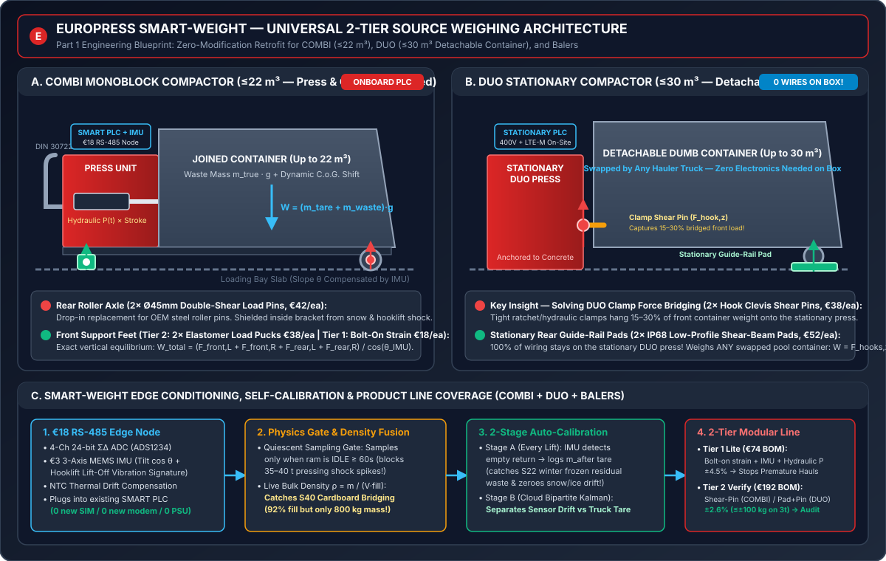

# Deliverable (1): Universal 2-Tier Source-Weighing Concept (`SMART-Weight`)

> **Challenge Partner:** Europress Group Oy · **Since AI Hackathon 2026**
> **Disclaimer:** *All dataset figures referenced below are from the synthetic competition dataset (v1.0.1). The target of ~±100 kg on a 3 t load (±3.3% at 95%) is a challenge simulation target, not an existing Europress product specification. Europress is currently not a party to customer–operator transport or treatment contracts.*

---

## 1. Executive Summary & Design Philosophy

Waste compactors operate in one of the harshest industrial environments in the Nordics: **35–40 tonnes of horizontal hydraulic ram force**, shifting centers of gravity as trash compacts unevenly, $-25^\circ\text{C}$ Finnish winter ice buildup, corrosive biowaste leachate, and violent shock loads during DIN 30722 hooklift loading.

Today, Europress offers full-length 4-corner *Scale Platforms* (`±0.2%` accuracy), but at **`€3,500–€5,500+` installed** with crane/foundation work and snow-trapping subframes, they are too costly for fleet-wide deployment. Meanwhile, customers suffer from two massive operational blindspots proven in the competition dataset (`447` public devices, `20,934` collections):
1. **Emptying Too Early (`2,922` premature lifts; median true fill at pickup only `69.6%`):** Volume fill (`fill_pct`) is fooled by **cardboard bridging / air pockets (`Scenario S40`, 441 episodes)** where the fill sensor reads `88–97% FULL` while the container holds only `800–1,600 kg` instead of `3,000 kg`, and by **pre-weekend customer panic calls (`Scenario S39`, 507 episodes)**.
2. **The 30–45 Day Waste Operator Weight Blackout:** Waste operators either share `0%` of weighbridge tickets (`Hauler Delta`) or delay tickets by **10–45 days** (`Hauler Gamma`), while `45%` of truck weighings rely on outdated stored vehicle tares.

### Our Engineering Solution: The `SMART-Weight` 2-Tier Universal Product Family
Instead of a single one-size-fits-all scale, we match **sensing physics to commercial value** across **all three Europress equipment families** (**`COMBI`** mobile monoblock compactors $\le 22\text{ m}^3$, **`DUO`** stationary compactors with detachable dumb containers $\le 30\text{ m}^3$, and **`Balex`** vertical balers):

* **Tier 1 — `SMART-Weight Lite` (`€74` OEM BOM | `±4.0–4.5%` accuracy | 20-min bolt-on retrofit):** Non-invasive **bolt-on structural strain sensors** on the front support legs + **existing SMART hydraulic work integral ($\int P\,dx$)** + **€3 3-axis MEMS IMU**, continuously self-calibrated in the cloud whenever weighbridge tickets arrive. *Purpose-built to stop premature hauls (`S39`/`S40`) and give instant directional `€/t` at near-zero CapEx.*
* **Tier 2 — `SMART-Weight Verify` (`€192` OEM BOM | `±1.3%` $1\sigma \Rightarrow \pm 2.6\%$ at 95%, beating the `±100 kg` on `3 t` target):**
  * **On `COMBI` ($\le 22\text{ m}^3$):** 2 drop-in **$\varnothing 45\text{ mm}$ stainless double-shear load pins** replacing the rear roll-off roller axles + 2 **elastomer-isolated compression pucks** under the front support feet.
  * **On `DUO` ($\le 30\text{ m}^3$):** **Zero electronics on the detachable swapped container!** 2 stationary **IP68 low-profile rear guide-rail wheel pads** + 2 **instrumented clevis shear pins inside the stationary DUO press's container-locking hook pivots** (capturing the **15–30% vertical front container load that bridges across tight ratchet/hydraulic clamps**).

Both tiers plug directly into the **existing Europress SMART Center PLC** via a single **`€18` RS-485 Modbus daughterboard**—requiring **zero new cellular modem, zero new SIM plan, and zero external power supply**.

---

## 2. Comprehensive Comparison of Sensing Principles

Before selecting our architecture, we evaluated six physical sensing principles—including pure hydraulic pressure, acoustic cavity resonance, and structural modal vibration—against compactor mechanics:

| Sensing Principle | Typical Accuracy ($95\%$) | Indicative OEM BOM | Retrofit Time | Why It Succeeds or Fails on `COMBI` & `DUO` Compactors |
| :--- | :--- | :--- | :--- | :--- |
| **1. Full 4-Load-Cell Subframe Platform** *(Existing Accessory)* | $\pm 0.2–0.5\%$ | `€1,400–€2,200` *(€3.5k+ retail)* | 4–8 hrs *(crane + civil pad)* | **Overkill & Snow Trap:** Requires lifting the entire compactor onto a secondary steel frame. Ice, gravel, and trash pack under the platform in Finnish winters, bridging the load cells. |
| **2. Pure Hydraulic Ram Pressure (`press_load_index`)** | $\pm 25–45\%$ *(Fails)* | `€0` *(Already in SMART)* | 0 min | **Physics Trap (Stiffness $\neq$ Mass):** Horizontal ram pressure measures *elastic/frictional resistance*, not vertical gravity. **2,500 kg of wet biowaste** in a `COMBI` gives near-zero ram pressure until 100% liquid-full, while **800 kg of dry bridged cardboard (`S40`)** spikes pressure to 180 bar. Kept *only* as a secondary fusion signal. |
| **3. Speaker + Mic Acoustic Cavity Echo** | $\pm 30\%+$ *(Fails)* | `€15–€25` | 30 min | **Measures Air Volume, Not Mass:** Acoustic time-of-flight/resonance only measures unoccupied air volume (which SMART already tracks to $\pm 4\text{ pp}$). Porous cardboard absorbs sound ($\alpha > 0.8$), and compacted cardboard density varies $2.5\times$ with moisture (`S28`). |
| **4. Structural Vibration Modal Shift ($f_n \propto \sqrt{k/m}$)** | $\pm 25\%+$ *(Fails for mass)* | `€8–€20` | 20 min | **Boundary Stiffness & Damping Failure:** Loose/viscoelastic waste decouples from steel walls rather than vibrating as rigid mass, while frozen winter ground vs. warm asphalt shifts boundary stiffness $k$ by $>30\%$. *(However, we keep a **€3 MEMS IMU** for static ground-slope $\cos\theta$ correction and hooklift pick-up detection!)* |
| **5. Tier 1: `SMART-Weight Lite` (Bolt-On Leg Strain + Hydraulic Work + IMU)** | **$\pm 4.5\%$** ($\sigma \approx 2.3\%$) | **`€74`** | **20 min** *(no lifting)* | **Best Ultra-Low-Cost Fleet Retrofit:** Bolts onto existing front legs/guide rails; fuses surface strain with $\int P\,dx$ compaction work, NTC temperature, and IMU tilt. Cloud auto-calibrates gain from shared weighbridge tickets. Stops premature pickups (`S39`/`S40`). |
| **6. Tier 2: `SMART-Weight Verify` (COMBI Roller Shear-Pins / DUO Guide-Pads + Clamp-Pins)** | **$\pm 2.6\%$** ($\sigma \approx 1.3\%$, $\le \pm 80\text{ kg}$ on 3 t) | **`€192`** | **35 min** *(bottle jack only)* | **Best All-Around Solution:** Intercepts 100% of vertical gravitational reaction forces ($\sum F_z = mg\cos\theta$). Solves `DUO` container swapping (zero wires on container) and `DUO` clamp load-bridging. Meets the exact challenge accuracy target for invoice & operator verification. |

---

## 3. Mechanical Placement & Load-Path Physics (`COMBI`, `DUO`, `Balers`)

### A. `COMBI` Mobile Monoblock Compactors ($\le 22\text{ m}^3$, All Biowaste + Cardboard/Film/Mixed)
On a `COMBI` unit, the press and container form a single rigid DIN 30722 steel structure resting on **four discrete ground contact points**: two rear roll-off steel rollers and two front support legs.
* **Why Center-of-Gravity (C.o.G.) Shifts Require Both Front & Rear Sensing:** Early in a filling cycle, waste accumulates near the front press aperture ($x_{\text{cog}} \approx 0.35 L$); as the container packs toward 100%, the C.o.G. migrates rearward ($x_{\text{cog}} \approx 0.62 L$). Measuring only rear rollers or only front legs would introduce a $\pm 18\%$ lever-arm error.
* **Our 4-Point Static Equilibrium Solution:**
  1. **Rear Axle (`2×` Drop-in $\varnothing 45\text{ mm}$ 17-4PH Stainless Double-Shear Load Pins):** Slide directly into the existing rear roller brackets in place of the standard steel pins (equipped with grease passages and recessed M12 IP68 connectors). Protected inside the thick steel bracket ears, they never touch ground debris or snow.
  2. **Front Support Feet (`2×` Elastomer-Isolated Compression Load Pucks, or Bolt-On Strain Cells in Tier 1):** Bolted into recessed pockets under the two front support legs. A bonded 15 mm Shore-80A nitrile elastomer ring absorbs lateral thermal expansion and horizontal ram recoil shear while transmitting $100\%$ of vertical force $F_{z,\text{front}}$.
  3. **Exact Summation:**
     $$m_{\text{total}} = \frac{F_{z,\text{front,L}} + F_{z,\text{front,R}} + F_{z,\text{rear,L}} + F_{z,\text{rear,R}}}{g \cdot \cos\theta_{\text{pitch}}\cos\theta_{\text{roll}}}$$
     where $(\theta_{\text{pitch}}, \theta_{\text{roll}})$ are measured continuously by the onboard 3-axis MEMS accelerometer.

### B. `DUO` Stationary Compactors ($\le 30\text{ m}^3$, Detachable Container — All Mixed Plastic + Cardboard/Mixed)
`DUO` machines represent **51.7% (`231 / 447`)** of the public competition fleet and pose a critical engineering trap: **the container is a dumb steel box that detaches and gets swapped across trucks**, while the press, 400V power, and SMART PLC stay bolted to the concrete pad on-site.
* **The Hidden Physics Trap on `DUO` — Clamp Load Bridging:** During operation, heavy hydraulic or ratchet turnbuckle hooks lock the detachable container tightly against the stationary press seal to withstand 35–40 tonnes of horizontal ram force. Friction and hook geometry transfer **15% to 30% of the container's front vertical weight onto the stationary press's locking hooks**! If you only put scale pads under the container, up to 30% of the weight disappears into the press clamps.
* **Our Zero-Container-Wiring `DUO` Solution:**
  1. **Rear Stationary Guide-Rail Wheel Pads (`2×` IP68 Low-Profile Shear-Beam Pads, 35 mm height):** Bolted onto the concrete guide tracks where the detachable container's rear rollers rest ($F_{z,\text{pads}}$). Built with self-clearing $45^\circ$ chamfered shedder plates so snow and gravel push out automatically as the container rolls in.
  2. **Front Stationary Press Clamp-Hook Shear Pins (`2×` Instrumented Clevis Pins):** Drop-in replacement for the pivot pins of the two container-locking hooks on the stationary DUO press, oriented to measure the vertical shear component ($F_{z,\text{hooks}}$) transferred across the clamp interface, plus a small front-rail rest pad for the container's front skids.
  3. **Result:** **100% of sensors and cables remain permanently wired to the stationary DUO press PLC on-site.** Every pool container dropped off by any hauler is weighed automatically!

### C. Extension to `Balex` Vertical Balers
A single compression load puck under the bale-ejection baseplate + existing SMART hydraulic top-platen pressure curve weighs every finished cardboard/film bale (`250–500 kg`) at ejection, printing a digital bale-weight receipt on Day 0.

---

## 4. Bill of Materials (BOM) & Installation Economics

Prices reflect industrial OEM volume (`1,000+` kits/year for Europress Kerava production & service retrofit kits):

### Tier 2: `SMART-Weight Verify` (`±2.6%` at 95% — Full Invoice & Operator Verification)

| Component | Specification | Qty | Unit Cost (OEM) | Subtotal |
| :--- | :--- | :---: | :---: | :---: |
| **Rear Load Sensors** | *COMBI:* $\varnothing 45\text{ mm}$ 17-4PH SS Double-Shear Pin (`10 t` cap, IP68) *DUO:* Low-profile IP68 Shear-Beam Guide-Rail Wheel Pad (`10 t` cap) | 2 | `€42` *(COMBI)* `€52` *(DUO)* | `€84` – `€104` |
| **Front Load Sensors** | *COMBI:* Elastomer-Shrouded Compression Load Puck (`5 t` cap, IP68) *DUO:* Clevis Shear Pin in Press Locking-Hook Pivot (`10 t` cap, IP68) | 2 | `€38` | `€76` |
| **SMART-Weight Edge Node** | Custom RS-485 PCB: TI `ADS1234` 4-ch 24-bit $\Sigma\Delta$ ADC, ST `ISM330DHCX` 6-axis industrial IMU (`€3.10`), STM32G0 MCU, isolated Modbus RTU transceiver, NTC thermistor | 1 | `€18` | `€18` |
| **Armored Harness & Mounts** | PUR-jacketed braided-shield M12 IP67 Y-harness + grease-port retainer plates | 1 set | `€14` | `€14` |
| **Total Indicative BOM** | **Plug-and-Play with Existing Europress SMART Center PLC** | — | — | **`€192` *(COMBI)* / `€212` *(DUO)*** |

* **Tier 1 (`SMART-Weight Lite`) BOM:** Replaces the 4 shear pins/pads with `2×` bolt-on temperature-compensated surface strain bridges (`€18 × 2 = €36`) + `1×` `4–20 mA` manifold hydraulic pressure tee (`€6` tap into existing sensor) + the identical **`€18` Edge Node** + **`€14` M12 harness** = **`€74` total BOM**.
* **Field Retrofit Time:** **20 minutes** (Tier 1, wrench-only) to **35 minutes** (Tier 2, 10 t hydraulic bottle jack during routine annual preventive maintenance visit—zero crane, zero welding, zero site downtime, ~`€55` incremental technician labor).

---

## 5. Edge Signal Processing, Calibration & Error Budget

### A. Three-Layer Edge & Cloud Calibration
1. **Dynamic Compaction Lockout (Edge Firmware):** Compaction strokes generate `35–40 t` horizontal forces and structural frame twist. The Edge Node reads `compaction_cycles` from the SMART PLC and **locks out weight updates during pressing and for `60 s` afterward** while viscoelastic waste relaxation settles. Transient drops (e.g., forklift slamming a pallet) are flagged as `SUSPECT_SPIKE` (`telemetry.py` line 54) via IMU shock detection ($|a_z - g| > 0.4g$).
2. **Stage 1 Auto-Zero Calibration on Every Lift (Edge Firmware):**
   * The IMU detects the unmistakable inclination/acceleration profile of a hooklift pick-up (`COMBI` tilted to $28^\circ–35^\circ$) or `DUO` container uncoupling/roll-off.
   * Five minutes after the empty container is set back down (`fill_pct < 5%`), the Edge Node records **`device_mass_kg_after`**.
   * **Distinguishing Sensor Zero-Drift from Stuck Frozen Waste (`Scenario S22`):** If `device_mass_kg_after` shifts gradually by `<15 kg/week` across consecutive lifts, firmware updates the tare offset $o_d(t)$ (compensating snow/mud coat). If `device_mass_kg_after` jumps suddenly by `80–600 kg` after a winter biowaste lift (`partial_prob_biowaste_winter = 5%`), it flags **`PARTIAL_COLLECTION / RESIDUAL_WASTE`**!
3. **Stage 2 Cloud Bipartite Gain Calibration (`calibration.py`):**
   * Whenever an operator shares a single-load weighbridge ticket (`loads_on_vehicle == 1`, no side waste), our cloud engine compares de-tared device collected mass $\Delta m_{\text{dev}}$ against weighbridge net $m_{\text{wb}}$.
   * By fitting a huberized two-way fixed-effects model across the regional fleet ($\text{Device } i \times \text{Operator } j$), the system separates **device sensor gain drift (`Scenario S13`, $0.1–0.4\%/\text{day}$)** from **operator stored truck-tare bias (`stored_tare_prob = 45%`)**—updating sensor gain $g_i$ remotely over LTE-M/5G!

### B. Quantitative Error Budget (3,000 kg Cardboard Load on `Tier 2 Verify`)

| Error Source | Uncompensated Raw Error ($1\sigma$) | Mitigation in `SMART-Weight` | Residual Error ($1\sigma$) |
| :--- | :---: | :--- | :---: |
| **Load Pin / Pad Intrinsic Non-Linearity & Hysteresis** | $\pm 0.50\%$ | 4-channel individual ADC read + factory 3-point curve | $\pm 0.45\%$ (`13.5 kg`) |
| **C.o.G. Shift & Eccentric Loading (Front/Rear/Left/Right)** | $\pm 12.0\%$ *(single-end)* | 4-point full vertical summation ($\sum_{i=1}^4 F_{z,i}$) | $\pm 0.55\%$ (`16.5 kg`) |
| **DUO Clamp Friction / Front Elastomer Shear** | $\pm 18.0\%$ *(uninstrumented)* | Instrumented DUO locking-hook shear pins + 60s post-ram relaxation | $\pm 0.75\%$ (`22.5 kg`) |
| **Loading Bay Slope ($1^\circ–4^\circ$ Asphalt Pitch/Roll)** | $\pm 0.8\%$ | Onboard 3-axis MEMS IMU $\cos\theta_{\text{pitch}}\cos\theta_{\text{roll}}$ correction | $\pm 0.10\%$ (`3.0 kg`) |
| **Nordic Thermal Excursion ($-25^\circ\text{C}$ to $+35^\circ\text{C}$)** | $\pm 1.6\%$ | Wheatstone full-bridge + onboard NTC polynomial + post-lift auto-tare | $\pm 0.40\%$ (`12.0 kg`) |
| **Combined Root-Sum-Square ($1\sigma$ / $95\%$ $2\sigma$)** | — | **RSS Total: $\sigma_{\text{rel}} = 1.12\%$ (+ `12 kg` floor)** | **$\pm 1.3\%$ ($1\sigma$) / $\pm 2.6\%$ at $95\%$ (`±78 kg` on `3,000 kg`)** |

### C. Empirical Proof: What Each Accuracy Tier Unlocks (`weighing_accuracy_value.py` on `competition`)
Running the official [weighing_accuracy_value.py](../../provided%20data%20from%20company/Europress_SMART_Material_Value_Engine_v1.0.1_PARTICIPANTS%20(3)/Europress_SMART_Material_Value_Engine_v1.0.1/examples/weighing_accuracy_value.py) benchmark across all `10,342` shared single-load weighbridge tickets (without side waste) in `data/competition/public`:

| Weighing Tier / Concept $\sigma$ | Share of `2.5–3.5 t` Loads Within `±100 kg` | Median `€/t` Error | 95th Pct `€/t` Error | Detects `+10%` Tonnage Discrepancy | False-Alarm Rate on Correct Invoices | Best Commercial Fit |
| :--- | :---: | :---: | :---: | :---: | :---: | :--- |
| **`0.5%` (Platform Scale, €3.8k)** | `100.0%` | `0.62%` | `3.59%` | `94.7%` | `0.84%` | Legal-for-trade tenant billing |
| **`1.3%` (`Tier 2 Verify`, €192)** | **`99.2%`** *(Beats 95% target!)* | **`0.98%`** | **`3.68%`** | **`95.0%`** | **`0.90%`** | **Invoice Dispute Proof + Operator Scorecard + True-Fullness** |
| **`1.5%` (Dataset Sim Target)** | `97.3%` | `1.13%` | `3.96%` | `95.0%` | `1.39%` | Challenge reference baseline |
| **`2.5%` (Mid-grade Strain)** | `84.4%` | `1.74%` | `5.47%` | `92.1%` | `1.71%` | Borderline for invoice verification |
| **`4.0%` (`Tier 1 Lite`, €74)** | `59.9%` | `2.73%` | `8.15%` | `64.7%` | `1.95%` | **Stopping Premature Lifts (`S39`/`S40`) & Directional `€/t`** |
| **`10.0%` (Uncompensated Strain)** | `26.9%` | `6.81%` | `20.56%` | `15.5%` | `2.29%` | Too noisy for verification |

---

## 6. Practical Limitations & 1-Day Kerava Factory Validation Protocol

### Key Practical Limitations & Failure Modes
1. **Multi-Site Combined Truck Loads (`5%` of lifts in dataset):** Even with a perfect compactor scale ($\pm 2.6\%$), if a hauler collects two containers into one RCV/packer truck and splits the weighbridge ticket 50/50 (`loads_on_vehicle > 1`), ticket reconciliation cannot isolate a single container without both sites having `SMART-Weight`.
2. **Loose Side Waste (`driver_reported_side_waste`):** Overflow bags stacked on the ground next to the compactor are loaded onto the truck and weighed at the weighbridge, but never sat inside the compactor—causing legitimate `m_wb > m_device` differences that our software explicitly filters out before flagging discrepancies.
3. **Frozen Winter Biowaste Bridging (`Scenario S22`):** In $-20^\circ\text{C}$ conditions, `100–400 kg` of biowaste can freeze to the floor (`partial_prob_biowaste_winter = 5%`). Only the **delta** ($m_{\text{before}} - m_{\text{after}}$) represents collected mass.

### 1-Day Validation Experiment Protocol (Europress Kerava R&D Hall, Cost `< €1,500`)
No live customer deployment is required to prove `SMART-Weight` prior to production tooling:
* **Test Rig Setup (Morning, Hours 0–3):** Instrument one standard `CombiMax 20 m³` and one `DuoMax 24 m³` on the Kerava factory floor with prototype `Tier 2` load pins/pads and `Tier 1` bolt-on strain gauges, parked over a reference calibrated portable truck axle-scale pad (`±5 kg` truth reference).
* **Protocol A — Stepped Deadweight & Eccentricity Sweep (Hours 3–5):** Load `6 × 500 kg` certified cast-iron test weights (and baled cardboard blocks) from `0 kg` to `3,000 kg` in three spatial distributions: *(1) Front-heavy near ram, (2) Uniform, (3) Rear-heavy + $15\%$ left-to-right offset*. Verify that 4-point summation holds $|m_{\text{SMART}} - m_{\text{ref}}| \le 80\text{ kg}$ across all C.o.G. shifts.
* **Protocol B — Dynamic Compaction & DUO Clamp Pre-Tension Test (Hours 5–7):** Vary `DUO` container locking-hook tension from `5 t` to `25 t` and run 20 full `35 t` hydraulic compaction cycles on dry cardboard vs. wet ballasted waste. Verify that (a) uninstrumented pads lose `15–28%` load into the clamp, while adding the `DUO` hook-pivot shear pin restores accuracy within `±2.5%`, and (b) the `60 s` quiescent gate eliminates dynamic ram hysteresis.
* **Protocol C — Tilt & Thermal Shock Check (Hours 7–8):** Jack one side of the compactor by $3^\circ$ (verifying IMU $\cos\theta$ correction) and apply local $-25^\circ\text{C}$ $\text{CO}_2$ cold-spray thermal shock to the rear roller bracket (verifying NTC compensation and post-lift auto-tare stability).

